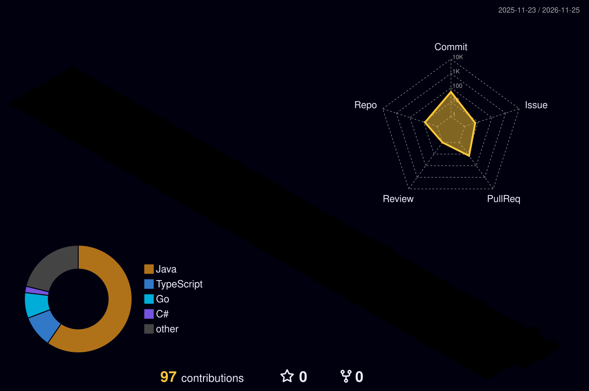

  
  <h3>热爱云计算与云原生的开发者</h3>
  

    
    
    
  

  

## 🙋 关于我

<table>
  <tr>
    <td width="46%" valign="top">
      
持续学习，探索云计算与云原生，也喜欢把重复的工作交给自动化。

      

        <strong>🧭 技术方向</strong> 
        • Linux 与系统运维 
        • 容器、Kubernetes 与云平台 
        • Ansible 自动化与可观测性
      

      

        <strong>🛠 正在构建</strong> 
        • <a href="https://github.com/CodeTrailblazer-Lyra/KeyGo">KeyGo</a> — Java 激活码分发系统后端 
        • <a href="https://github.com/CodeTrailblazer-Lyra/Keygo_Web_React">Keygo Web</a> — React + TypeScript 管理前端
      

      

        <strong>🎯 近期重点</strong> 
        • 完善项目文档与自动化部署流程 
        • 深入 Kubernetes 运维与可观测性 
        • 沉淀 Ansible 自动化实践
      

      

        <strong>🌱 正在关注</strong> 
        云原生基础设施、自动化交付，以及稳定易用的开发者工具。
      

      

        <strong>📚 持续分享</strong> 
        记录 Linux、云原生与自动化交付中的实践、踩坑和解决方案。
      

      

        <strong>🤝 欢迎交流</strong> 
        如果你也对云原生、自动化或开发者工具感兴趣，欢迎通过 Issues 和 Discussions 一起讨论。
      

      
<strong>✨ 我相信</strong> 把复杂的事情做简单，把重复的事情交给自动化。

    </td>
    <td width="54%" valign="top">
      

        

          
          
        

        
      

    </td>
  </tr>
</table>

## 🧰 SRE 技术栈

  <h3>云平台与网络</h3>
  

    
  

  <h3>容器与基础设施即代码</h3>
  

    
  

  <h3>自动化与持续交付</h3>
  

    
  

  <h3>可观测性与稳定性</h3>
  

    
  

  <h3>数据与缓存</h3>
  

    
    &nbsp;
    
  

  <h3>开发与协作工具</h3>
  

    
  

<!--
## 🚀 精选项目

<table>
  <tr>
    <td width="50%" valign="top">
      

        <h3>KeyGo</h3>
        
激活码分发系统后端，使用 Java 构建。

        

          
          
        

        

          
        

      

    </td>
    <td width="50%" valign="top">
      

        <h3>Keygo Web</h3>
        
激活码分发管理前端，基于 React 与 TypeScript。

        

          
          
          
        

        

          
        

      

    </td>
  </tr>
</table>
-->

## 🐍 贡献动态

  
<strong>查看贪吃蛇与 3D 贡献图</strong>

   
  

    <picture>
      <source media="(prefers-color-scheme: dark)" srcset="https://raw.githubusercontent.com/CodeTrailblazer-Lyra/CodeTrailblazer-Lyra/main/assets/snake-dark.svg" />
      
    </picture>
      
    
  

---

  
  

    
  

  
<i>保持好奇，持续探索。</i>

